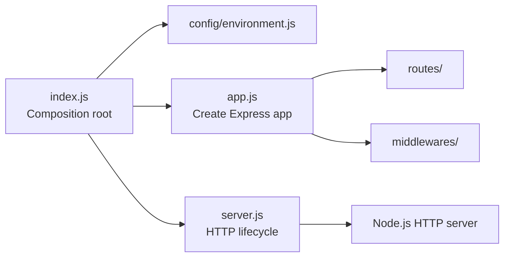
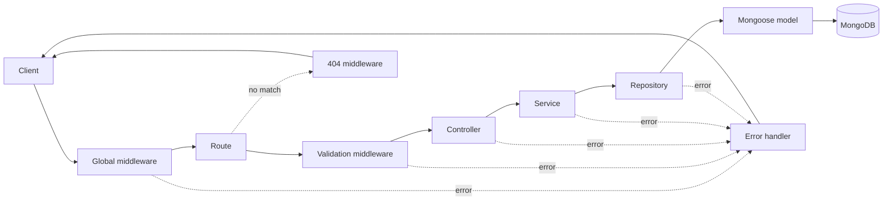
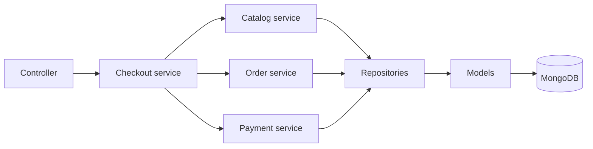

# Avengers API

The backend API for a MERN-stack e-commerce platform that sells licensed video
games, similar to Steam and the Epic Games Store.

The API is written in plain JavaScript, uses Express and native ECMAScript
modules, and runs on Node.js 24. The codebase follows a strict Layered
Architecture organized by technical responsibility.

## Database

The API connects to MongoDB Atlas with Mongoose using the driver defaults. Atlas
clusters are replica sets, so multi-document transactions are available without
extra configuration, and the driver already retries transient network failures.

The connection is opened before the HTTP server starts listening: if the cluster
is unreachable the process exits instead of serving traffic in a broken state.
On shutdown the connection is closed through the existing `onShutdown` hook, and
`/health/ready` reports the connection through a short `ping`.

Connection strings contain a password, so they are redacted from logs.

### Migrations

Mongoose creates the indexes a model declares when the API starts, and a new
field takes its schema `default` on old documents. Anything beyond that, such as
changing or dropping an index, renaming a field or filling in values for old
documents, is a migration in `migrations/`, run with
[migrate-mongo](https://github.com/seppevs/migrate-mongo).

```sh
npm run migrate -- create rename-post-author   # adds migrations/<timestamp>-rename-post-author.js
npm run migrate -- up                          # runs what has not run yet
```

Each file exports `up(db, client)` and `down(db, client)`, using the MongoDB
driver directly rather than the models, which keep changing after the migration
is written. Write `up` so it can run again safely, and make `down` refuse,
rather than lose data, when it cannot undo cleanly.

The ones that ran are recorded in the `migrations` collection. Run
`npm run migrate -- up` on every deploy before the new version starts; a lock in
`migrations_lock` keeps two deploys from migrating at once and clears itself
after 10 minutes if a run is killed. `npm run seed` builds the latest schema
directly, so it records every existing migration as already applied.

## Redis

The API uses a [Redis Cloud](https://redis.io/cloud/) database, reached through
`REDIS_URL`. MongoDB keeps what must last: users, linked Google and Facebook
accounts, and the catalogue. Redis keeps what is short-lived and read on every
request, each key expiring on its own:

| Key (after `REDIS_KEY_PREFIX`)      | Type   | Holds                                                     |
| ----------------------------------- | ------ | --------------------------------------------------------- |
| `session:<userId>`                  | hash   | The user's one session: id, refresh token hash, role, ... |
| `refresh:<hash>`                    | string | Refresh token → user, to find the session from the cookie |
| `refresh-prev:<hash>`               | string | The token replaced last, to tell reuse from expiry        |
| `user-token:<hash>`                 | string | An emailed link (verify, reset, change email), one use    |
| `user-token-latest:<userId>:<type>` | string | The newest link of a kind, so a new one replaces it       |
| `email-cooldown:<userId>:<type>`    | string | Present for 60 seconds after an email is sent             |
| `rate-limit:<name>:<ip>`            | string | Rate-limit counters, shared by every API process          |

A request is authorised from one Redis read: the session holds the role and the
verified flag, updated whenever the user changes. Writes that touch several keys
(starting, rotating or ending a session, issuing a link) run as Lua scripts,
which Redis applies atomically.

Like MongoDB, Redis must be reachable when the API starts, or it exits with a
clear error. If the connection drops later, it reconnects on its own; meanwhile
requests that need a session or a sign-in limit answer `503`, the catalogue
keeps working, and `/health/ready` reports `redis` as down. Losing Redis data
signs everyone out, but no account or order is lost, so the Redis Cloud database
should have data persistence (append-only file) turned on.

Environments that share one Redis Cloud database must each set their own
`REDIS_KEY_PREFIX`, such as `avengers-dev:` and `avengers:`.

## Technology Stack

- MongoDB Atlas for persistent data storage
- Redis Cloud for sessions, emailed links and rate limits
- Express for the HTTP API
- React for the separate frontend application
- Node.js 24 for the backend runtime

## Requirements

- Node.js `>=24.11.0 <25`
- npm `>=11`
- A MongoDB Atlas cluster and a Redis Cloud database

## Getting Started

Install the locked dependencies:

```sh
npm ci
```

Create a local environment file from the provided example:

```sh
cp .env.example .env
```

On Windows Command Prompt, use `copy .env.example .env` instead. Then fill in
the required values: `MONGODB_URI`, `REDIS_URL` (from the Redis Cloud database's
"Connect" panel), `JWT_SECRET` and `KEY_ENCRYPTION_KEY`.

Start the development server:

```sh
npm run dev
```

The API is available at `http://localhost:8000` by default.

## Environment Variables

| Variable                              | Default                         | Description                                                                 |
| ------------------------------------- | ------------------------------- | --------------------------------------------------------------------------- |
| `MONGODB_URI`                         | required                        | MongoDB Atlas connection string                                             |
| `MONGODB_DB_NAME`                     | `avengers`                      | Database name in the cluster                                                |
| `REDIS_URL`                           | required                        | Redis Cloud connection string; `rediss://` for TLS, password in the URL     |
| `REDIS_KEY_PREFIX`                    | `avengers:`                     | Prefix of every Redis key, so environments can share one Redis              |
| `JWT_SECRET`                          | required                        | Access-token signing key, at least 32 bytes                                 |
| `NODE_ENV`                            | `development`                   | Either `development` or `production`                                        |
| `HOST`                                | `localhost`                     | Hostname used by the HTTP server                                            |
| `PORT`                                | `8000`                          | Port used by the HTTP server                                                |
| `LOG_LEVEL`                           | `debug` / `info` in prod        | Pino log level                                                              |
| `CORS_ORIGINS`                        | empty                           | Comma-separated allowed origins; empty allows **no** cross-origin requests  |
| `ACCESS_TOKEN_TTL_MINUTES`            | `15`                            | Lifetime of an access token                                                 |
| `REFRESH_TOKEN_TTL_DAYS`              | `30`                            | Lifetime of a session (refresh token)                                       |
| `APP_URL`                             | `http://localhost:3000`         | Frontend URL used to build the links in emails                              |
| `SMTP_HOST`                           | empty; required in production   | SMTP server; when empty, emails are only logged                             |
| `SMTP_PORT`                           | `587`                           | `465` uses TLS directly, other ports STARTTLS                               |
| `SMTP_USER`, `SMTP_PASS`              | empty                           | SMTP credentials                                                            |
| `MAIL_FROM`                           | `Avengers <no-reply@localhost>` | Sender of outgoing emails                                                   |
| `KEY_ENCRYPTION_KEY`                  | required                        | 32 random bytes in base64; encrypts game keys at rest                       |
| `ORDER_HOLD_MINUTES`                  | `10`                            | How long checkout holds keys while the shopper pays                         |
| `ORDER_PAYMENT_GRACE_SECONDS`         | `300`                           | Extra time an expired order keeps its keys for a late payment               |
| `ORDER_SWEEP_INTERVAL_SECONDS`        | `30`                            | How often expired orders are closed and their keys put back on sale         |
| `VNPAY_TMN_CODE`, `VNPAY_HASH_SECRET` | empty                           | VNPay terminal code and secret; payment is offered only when both are set   |
| `VNPAY_PAY_URL`, `VNPAY_API_URL`      | VNPay sandbox                   | Payment page and transaction API; set to VNPay's production URLs to go live |
| `CLOUDINARY_CLOUD_NAME`               | empty                           | Cloudinary cloud; admin uploads are offered only when the next two are set  |
| `CLOUDINARY_API_KEY`, `..._SECRET`    | empty                           | Cloudinary API key and secret; the secret never leaves the API              |
| `CLOUDINARY_FOLDER`                   | `avengers`                      | Folder every upload lands in; only files inside it are ever deleted         |

`MONGODB_URI`, `REDIS_URL`, `JWT_SECRET` and `KEY_ENCRYPTION_KEY` are required.
Generate a secret with
`node -e "console.log(require('crypto').randomBytes(48).toString('base64url'))"`
and an encryption key with
`node -e "console.log(require('crypto').randomBytes(32).toString('base64'))"`.
Never change `KEY_ENCRYPTION_KEY` on its own: keys stocked under one value
cannot be read with another. `PORT` must be an integer between `1` and `65535`.
Blank values are treated as missing and fall back to the default.

Stack traces appear in error responses outside production and are always
suppressed when `NODE_ENV=production`.

Request timeouts are left to the Node.js HTTP server, which already aborts a
request after 300 seconds and incomplete headers after 60. `trust proxy` stays
at the Express default, so `X-Forwarded-For` is ignored and the real socket
address is used; enable it explicitly if the API is ever placed behind a reverse
proxy, otherwise clients can spoof their IP and bypass rate limiting.

## API Endpoints

Business endpoints are served under the `/api/v1` prefix. Health probes are
deliberately unversioned and exempt from rate limiting, because platform health
checks poll a fixed path and must never be throttled into a false negative.

| Method | Path            | Description                                    |
| ------ | --------------- | ---------------------------------------------- |
| `GET`  | `/api/v1`       | Returns a JSON welcome response                |
| `GET`  | `/health/live`  | Liveness: the process is running               |
| `GET`  | `/health/ready` | Readiness: dependencies usable; `503` when not |

### Catalogue

| Method | Path                             | Description                                                                           |
| ------ | -------------------------------- | ------------------------------------------------------------------------------------- |
| `GET`  | `/api/v1/products`               | `?page&limit&sort&collection&platform&category&q&minPrice&maxPrice`                   |
| `GET`  | `/api/v1/products/:slug`         | One product with its variants, categories, gallery and descriptions; `404` if none    |
| `GET`  | `/api/v1/products/:slug/related` | `?limit` (default 4, max 12); products sharing the most categories, best sellers next |
| `GET`  | `/api/v1/products/:slug/reviews` | `?page&limit`; newest first                                                           |
| `GET`  | `/api/v1/product-categories`     | Genres such as Action Games or FPS                                                    |

### Content

| Method | Path                  | Description                                                            |
| ------ | --------------------- | ---------------------------------------------------------------------- |
| `GET`  | `/api/v1/posts`       | `?page&limit&category&q`; newest first                                 |
| `GET`  | `/api/v1/posts/:slug` | One post with its `content` and up to 2 `related` posts; `404` if none |
| `GET`  | `/api/v1/pages/:slug` | `faq`, `refund-policy`, `terms` or `privacy`: title, summary, sections |
| `GET`  | `/api/v1/media`       | `?type=screenshot\|video&limit` (max 50); videos carry a `title`       |
| `GET`  | `/api/v1/galleries`   | `?limit` (default 6, max 24); albums with a `cover` and their `images` |

Post bodies and page sections are plain text: blocks are separated by a blank
line, and a block starting with `### ` is a subheading. Pages live in the
`pages` collection so they can change without a release; their first content
comes from `scripts/pages-data.json`, which the migration inserts only where a
page does not exist yet.

### Comments

| Method   | Path                               | Auth     | Description                                                |
| -------- | ---------------------------------- | -------- | ---------------------------------------------------------- |
| `GET`    | `/api/v1/posts/:slug/comments`     | optional | `?page&limit` (default 20, max 50); threads oldest first   |
| `POST`   | `/api/v1/posts/:slug/comments`     | token    | `{ body: 2-2000 chars, parentId? }`; published at once     |
| `PATCH`  | `/api/v1/posts/:slug/comments/:id` | token    | `{ body }`; the author's own comment only, marked `edited` |
| `DELETE` | `/api/v1/posts/:slug/comments/:id` | token    | The author's own comment only                              |

Signed-in readers comment on blog posts. Threads are one level deep: a reply to
a reply joins the thread of the first comment. The listing pages through threads
(`meta.total`), each with all its `replies`; `meta.commentCount` counts every
comment. Listed comments carry `mine` for a signed-in reader.

A first comment that still has replies is kept as `deleted` (no author, no text)
when its author deletes it, and removed once its last reply goes. Replying to a
deleted comment is `404`. Every write recomputes the post's `commentCount` in
the same transaction, so a reply racing the deletion of the comment it answers
either fails or keeps the thread, and the count stays right. Deleting an account
deletes its comments the same way.

### Reviews

| Method   | Path                                  | Auth  | Description                                                  |
| -------- | ------------------------------------- | ----- | ------------------------------------------------------------ |
| `GET`    | `/api/v1/products/:slug/reviews/mine` | token | `{ canReview, purchased, review }` for the signed-in shopper |
| `POST`   | `/api/v1/products/:slug/reviews`      | token | `{ rating: 1-5, content: 10-2000 chars }`; buyers only       |
| `PATCH`  | `/api/v1/products/:slug/reviews/mine` | token | `{ rating, content }`                                        |
| `DELETE` | `/api/v1/products/:slug/reviews/mine` | token | Deletes the shopper's review                                 |

Only a shopper with a paid order for a game may review it
(`403 REVIEW_NOT_ALLOWED`), once (`409 REVIEW_EXISTS`, enforced by a unique
index). Listed reviews carry `verifiedPurchase` and, for a signed-in reader,
`mine`. Every write recomputes the product's `ratingAverage` and `ratingCount`
from its reviews in the same transaction, so concurrent reviews cannot leave
them wrong. Deleting an account deletes its reviews.

`sort` is one of `-sales` (default), `-rating`, `-releaseDate`, `releaseDate`,
`-discount`, `price` and `-price`. A product matches `minPrice`/`maxPrice` when
one of its variants (on `platform`, if given) is priced within the range. The
listing's `meta.priceRange` holds the cheapest and dearest price among the
matches before the price filter, for a price slider.

### Cart

| Method   | Path                            | Auth  | Description                                                   |
| -------- | ------------------------------- | ----- | ------------------------------------------------------------- |
| `POST`   | `/api/v1/cart/preview`          | –     | `{ items: [{ variantId, quantity }] }`; prices a guest cart   |
| `GET`    | `/api/v1/cart`                  | token | The signed-in shopper's cart                                  |
| `POST`   | `/api/v1/cart/items`            | token | `{ variantId, quantity? }`; adds to the line, up to its limit |
| `PATCH`  | `/api/v1/cart/items/:variantId` | token | `{ quantity }`                                                |
| `DELETE` | `/api/v1/cart/items/:variantId` | token | Removes the line                                              |
| `DELETE` | `/api/v1/cart`                  | token | Empties the cart                                              |
| `POST`   | `/api/v1/cart/merge`            | token | `{ items }`; adds the guest cart in after signing in          |

Guests keep their cart in the browser and the API prices it with `preview`. A
cart stores only variant ids and quantities: names, prices and stock are read
from the catalogue on every response, so totals are never stale. Each line
reports `status` `ok`, `limited` (more than is left) or `sold_out`, and
`maxQuantity` (at most 5 keys of a variant per order, and never more than the
stock). A cart holds at most 20 lines. A stored cart saved under a higher cap is
lowered to it when read, and that response carries `adjusted: true`. Only `ok`
lines count towards `summary.subtotal`; `summary.canCheckout` is `false` until
every line is `ok`. Games that left the catalogue are dropped and listed once in
`removed`. Writes are guarded by a revision number, so two tabs changing the
cart at the same time cannot lose each other's change.

### Orders

| Method | Path                            | Auth  | Description                                                    |
| ------ | ------------------------------- | ----- | -------------------------------------------------------------- |
| `POST` | `/api/v1/orders`                | token | `{ idempotencyKey, expectedTotal }`; checks out the cart       |
| `GET`  | `/api/v1/orders`                | token | `?page&limit`; newest first                                    |
| `GET`  | `/api/v1/orders/pending`        | token | The unpaid order, or `null`                                    |
| `GET`  | `/api/v1/orders/:number`        | token | One order; a paid one includes its keys                        |
| `POST` | `/api/v1/orders/:number/cancel` | token | Cancels an unpaid order; `409 ORDER_NOT_PENDING` once it ended |

Prices are whole VND. Checking out turns the cart into a `pending` order, copies
names and prices into it, and holds its keys for `ORDER_HOLD_MINUTES` (10). An
unpaid order then becomes `expired`; its keys stay held for
`ORDER_PAYMENT_GRACE_SECONDS` more, so a payment finished at the last second
still gets them, and a sweep every `ORDER_SWEEP_INTERVAL_SECONDS` puts them back
on sale.

Concurrency is handled by the database, not by timing:

- keys are reserved in a transaction that decrements the variant's
  `availableKeys` only while it is high enough, so two shoppers can never get
  the same last key (the other gets `409 OUT_OF_STOCK`);
- a partial unique index allows one `pending` order per shopper, so two tabs
  checking out at once produce one order (`409 PENDING_ORDER_EXISTS`);
- the client's `idempotencyKey` makes a repeated request answer the same order;
- `expectedTotal` must match the cart's current total (`409 PRICE_CHANGED`);
- cancelling, expiring and releasing keys are conditional writes, so they can
  race each other, and several API instances can sweep at once, without
  releasing a key twice.

### Payments (VNPay)

| Method | Path                                           | Auth      | Description                                                      |
| ------ | ---------------------------------------------- | --------- | ---------------------------------------------------------------- |
| `GET`  | `/api/v1/payments/methods`                     | –         | `["vnpay"]` when VNPay is configured, otherwise `[]`             |
| `POST` | `/api/v1/orders/:number/payments/vnpay`        | token     | Starts a payment; answers `{ url }` to send the shopper to       |
| `POST` | `/api/v1/orders/:number/payments/vnpay/return` | token     | `{ params }` from VNPay's redirect; answers the payment's status |
| `GET`  | `/api/v1/payments/vnpay/ipn`                   | signature | VNPay's server-to-server result; answers `{ RspCode, Message }`  |

Each click on "Pay" is a payment record with its own `txnRef`, and VNPay's
expiry for it is the order's hold, so VNPay refuses payment once the keys are no
longer held. The result is taken only from VNPay: the IPN, or `querydr` when the
shopper returns before the IPN arrived. Parameters on the return URL are
verified but never trusted for the result.

Confirming a payment is one transaction: the order becomes `paid` only if it is
not paid yet, its reserved keys become `sold`, and the payment `succeeded`. So
duplicate IPNs, an IPN and a return at once, or two payments for one order all
end with exactly one paid order. Money that cannot be used is recorded as
`refund_required` and can be refunded through the admin's VNPay refund action:

- a second successful payment for an order that is already paid;
- a payment that arrives after the order's keys went back on sale, when too few
  are left to hold again. (If enough are left, they are held again and the order
  is paid as usual.)

  Refunds are full-amount only. Automatic refund requires the original VNPay
  transaction number and creation date. A signed rejection is saved as a failed
  attempt; a timeout or untrusted response is marked unknown and must be
  reconciled in the VNPay merchant portal before another attempt.

After a payment the bought games leave the cart and, if the account has an email
address, the keys are emailed once. VNPay must be able to reach
`$API_URL/api/v1/payments/vnpay/ipn` over HTTPS; on a laptop, `querydr` confirms
payments instead.

Keys are stored encrypted with AES-256-GCM under `KEY_ENCRYPTION_KEY`, with an
HMAC fingerprint that stops the same code being stocked twice. In development,
`npm run keys:fake -- --per-variant 50` tops every variant up with fake keys.

### Authentication

| Method   | Path                                 | Auth   | Description                                                 |
| -------- | ------------------------------------ | ------ | ----------------------------------------------------------- |
| `POST`   | `/api/v1/auth/register`              | –      | Creates a `user` account and signs it in                    |
| `POST`   | `/api/v1/auth/login`                 | –      | `{ email, password, remember }`; ends any other session     |
| `POST`   | `/api/v1/auth/refresh`               | cookie | Rotates the refresh cookie, returns a new access token      |
| `POST`   | `/api/v1/auth/logout`                | cookie | Ends the session and clears the cookie                      |
| `GET`    | `/api/v1/auth/me`                    | token  | The signed-in user                                          |
| `POST`   | `/api/v1/auth/verify-email`          | –      | `{ token }` from the emailed link                           |
| `POST`   | `/api/v1/auth/verify-email/resend`   | token  | Sends a new link; 60-second cooldown                        |
| `POST`   | `/api/v1/auth/forgot-password`       | –      | `{ email }`; always `200`, so accounts cannot be discovered |
| `POST`   | `/api/v1/auth/reset-password`        | –      | `{ token, password }`; signs the account out everywhere     |
| `PATCH`  | `/api/v1/auth/me`                    | token  | `{ displayName }`                                           |
| `DELETE` | `/api/v1/auth/me`                    | token  | `{ password }`; deletes the account, `403` for admins       |
| `POST`   | `/api/v1/auth/change-password`       | token  | `{ currentPassword, newPassword }`; answers a new session   |
| `POST`   | `/api/v1/auth/change-email`          | token  | `{ email, password }`; mails a link to the new address      |
| `DELETE` | `/api/v1/auth/change-email`          | token  | Cancels a pending email change                              |
| `POST`   | `/api/v1/auth/change-email/confirm`  | –      | `{ token }` from the link; switches the address             |
| `GET`    | `/api/v1/admin/contact-messages`     | admin  | `?page&limit&status=new\|read\|replied`                     |
| `PATCH`  | `/api/v1/admin/contact-messages/:id` | admin  | `{ status }`                                                |

### Administration

| Method   | Path                                                  | Description                                                                            |
| -------- | ----------------------------------------------------- | -------------------------------------------------------------------------------------- |
| `GET`    | `/api/v1/admin/overview`                              | `?days=7\|30\|90`; order, revenue, user, stock and inbox figures                       |
| `GET`    | `/api/v1/admin/orders`                                | `?page&limit&status&q`; `q` matches the number or customer                             |
| `GET`    | `/api/v1/admin/orders/:number`                        | One order with its lines and payments; never the key codes                             |
| `GET`    | `/api/v1/admin/payments`                              | `?page&limit&status`; `status=refund_required` lists owed refunds                      |
| `POST`   | `/api/v1/admin/payments/:id/refund/vnpay`             | `{ note? }`; asks VNPay to refund the full payment; signed result is recorded          |
| `POST`   | `/api/v1/admin/payments/:id/refund`                   | `{ note? }`; records a refund already completed manually outside the API               |
| `GET`    | `/api/v1/admin/users`                                 | `?page&limit&role&q`; each with order count and amount paid                            |
| `GET`    | `/api/v1/admin/users/:id`                             | One account with its latest orders                                                     |
| `GET`    | `/api/v1/admin/platforms`                             | Every platform, hidden ones included                                                   |
| `POST`   | `/api/v1/admin/platforms`                             | `{ name, slug, imageUrl, sortOrder? }`; starts hidden                                  |
| `PATCH`  | `/api/v1/admin/platforms/:id`                         | Updates platform details or `{ published }`                                            |
| `DELETE` | `/api/v1/admin/platforms/:id`                         | Only when no product variant uses the platform                                         |
| `GET`    | `/api/v1/admin/product-categories`                    | Every product category                                                                 |
| `POST`   | `/api/v1/admin/product-categories`                    | `{ name, slug, sortOrder? }`                                                           |
| `PATCH`  | `/api/v1/admin/product-categories/:id`                | Updates a category                                                                     |
| `DELETE` | `/api/v1/admin/product-categories/:id`                | Only when no product uses the category                                                 |
| `GET`    | `/api/v1/admin/products`                              | `?page&limit&q&published=true\|false`; variants with stock levels                      |
| `POST`   | `/api/v1/admin/products`                              | `{ name, slug, imageUrl, releaseDate, ... }`; starts hidden                            |
| `GET`    | `/api/v1/admin/products/:id`                          | One product with its variants and key counts                                           |
| `PATCH`  | `/api/v1/admin/products/:id`                          | Any product field, or `{ published }` to show or hide it                               |
| `POST`   | `/api/v1/admin/products/:id/variants`                 | `{ platformId, edition, price, originalPrice? }`                                       |
| `PATCH`  | `/api/v1/admin/products/:id/variants/:variantId`      | Any variant field                                                                      |
| `DELETE` | `/api/v1/admin/products/:id/variants/:variantId`      | Only while the variant never had a key (`409` otherwise)                               |
| `POST`   | `/api/v1/admin/products/:id/variants/:variantId/keys` | `{ codes }`, one per line; encrypted, never echoed back                                |
| `GET`    | `/api/v1/admin/banners`                               | Every home banner, in display order                                                    |
| `POST`   | `/api/v1/admin/banners`                               | `{ title, excerpt, imageUrl, linkUrl?, linkLabel?, sortOrder? }`                       |
| `PATCH`  | `/api/v1/admin/banners/:id`                           | Any banner field, or `{ published }`                                                   |
| `DELETE` | `/api/v1/admin/banners/:id`                           | Removes the banner                                                                     |
| `GET`    | `/api/v1/admin/post-categories`                       | Every blog category                                                                    |
| `POST`   | `/api/v1/admin/post-categories`                       | `{ name, slug, sortOrder? }`; the reserved `all` slug cannot be used                   |
| `PATCH`  | `/api/v1/admin/post-categories/:id`                   | Updates a blog category                                                                |
| `DELETE` | `/api/v1/admin/post-categories/:id`                   | Only when no post uses the category                                                    |
| `GET`    | `/api/v1/admin/pages`                                 | FAQ, refund policy, terms and privacy pages                                            |
| `PATCH`  | `/api/v1/admin/pages/:slug`                           | Updates `{ title, summary, sections, published }` for a known page                     |
| `GET`    | `/api/v1/admin/galleries`                             | Every gallery album, including hidden ones                                             |
| `POST`   | `/api/v1/admin/galleries`                             | Creates an album with a cover and image list                                           |
| `PATCH`  | `/api/v1/admin/galleries/:id`                         | Updates album details or `{ published }`                                               |
| `DELETE` | `/api/v1/admin/galleries/:id`                         | Removes an album                                                                       |
| `GET`    | `/api/v1/admin/media`                                 | Every screenshot and video, including hidden ones                                      |
| `POST`   | `/api/v1/admin/media`                                 | Creates a media item with type, image and target URL                                   |
| `PATCH`  | `/api/v1/admin/media/:id`                             | Updates media details or `{ published }`                                               |
| `DELETE` | `/api/v1/admin/media/:id`                             | Removes a media item                                                                   |
| `GET`    | `/api/v1/admin/social-links`                          | Every footer social link                                                               |
| `POST`   | `/api/v1/admin/social-links`                          | `{ network, label, url, sortOrder? }`; starts hidden                                   |
| `PATCH`  | `/api/v1/admin/social-links/:id`                      | Updates link details or `{ published }`                                                |
| `DELETE` | `/api/v1/admin/social-links/:id`                      | Removes a social link                                                                  |
| `GET`    | `/api/v1/admin/posts`                                 | `?page&limit&q&published&categoryId`; without the body text                            |
| `POST`   | `/api/v1/admin/posts`                                 | `{ title, slug, excerpt, content?, imageUrl, categoryId, publishedAt }`; starts hidden |
| `GET`    | `/api/v1/admin/posts/:id`                             | One post with its body text                                                            |
| `PATCH`  | `/api/v1/admin/posts/:id`                             | Any post field, or `{ published }`                                                     |
| `DELETE` | `/api/v1/admin/posts/:id`                             | Removes the post and all its comments                                                  |
| `GET`    | `/api/v1/admin/comments`                              | `?page&limit&q&postId`; newest first across every post                                 |
| `DELETE` | `/api/v1/admin/comments/:id`                          | Takes a comment down, as if its author had deleted it                                  |
| `GET`    | `/api/v1/admin/uploads`                               | `{ enabled }`: whether Cloudinary uploads are configured                               |
| `POST`   | `/api/v1/admin/uploads/signature`                     | `{ resourceType: image\|video }`; a signed Cloudinary upload, valid for one hour       |

All of them require an admin with a verified email, like every `/admin` route.
Responses are built field by field, so password hashes and key codes never leave
the API through them.

Automatic VNPay refunds use the configured merchant transaction API and are full
refunds only. The payment must be owed back and have its original VNPay
transaction number and creation date. A signed rejection is recorded as failed
and may be retried. A timeout, invalid response, or other uncertain result is
recorded as `unknown`; reconcile it in the VNPay merchant portal before
retrying, to avoid a duplicate refund. The manual endpoint remains available for
refunds already completed outside the API. Configure `VNPAY_TMN_CODE`,
`VNPAY_HASH_SECRET` and `VNPAY_API_URL` for the intended environment; never
expose these credentials to the shop or admin browser.

Images and videos are either third-party URLs pasted by an admin or files the
admin uploads to Cloudinary. Uploads go straight from the browser to Cloudinary
with a signature from `/admin/uploads/signature`, so files never pass through
the API and the secret stays on the server; the signature fixes the folder and
the allowed formats (images: jpg, png, webp, gif, avif; videos: mp4, webm, mov).
Either way only the delivery URL is stored. When an edit or a delete leaves an
uploaded file unused by every product, order, banner, post, gallery, media item
and platform, the API deletes it from Cloudinary and purges the CDN copy.
Third-party URLs and files outside `CLOUDINARY_FOLDER` are never touched, and a
failed delete is only logged.

Sign-in, sign-up and refresh answer `{ data: { user, accessToken } }`. The
access token (JWT, HS256, ~15 minutes) is sent as `Authorization: Bearer` and
should be kept in memory only. The refresh token is a random value in an
`httpOnly`, `SameSite=Lax` cookie scoped to `/api/v1/auth` (`Secure` in
production); with `remember: true` it lasts `REFRESH_TOKEN_TTL_DAYS`, otherwise
until the browser closes. It is rotated on every refresh, and presenting a
replaced token again ends the session.

An account has **one** session at a time, kept in Redis: signing in elsewhere
replaces it, and the previous device's next request gets `401` with code
`SESSION_REVOKED`. A session that was signed out, has expired or belonged to a
deleted account answers `401` with code `SESSION_ENDED` instead. Every
authenticated request checks the session in Redis, so these apply at once.

Not signed in is `401`; signed in without the required role is `403`. Every
`/admin` route requires the `admin` role and a verified email. Admins are
created only with `npm run create-admin`; sign-up always creates `user`.

Login is limited to 10 attempts per 15 minutes per IP, and sign-up and email
sending to 5 per hour (20 times more in development). The counters live in
Redis, so they hold across restarts and every API process shares them. While
Redis is unreachable these limited routes answer `503` rather than run
unguarded; the general limit lets traffic through.

### Sign-in with Google and Facebook

| Method   | Path                                    | Auth     | Description                                               |
| -------- | --------------------------------------- | -------- | --------------------------------------------------------- |
| `GET`    | `/api/v1/auth/oauth/providers`          | –        | Providers with credentials, e.g. `["google","facebook"]`  |
| `POST`   | `/api/v1/auth/oauth/:provider/start`    | optional | `{ intent, remember, redirect }`; answers `{ url }`       |
| `GET`    | `/api/v1/auth/oauth/:provider/callback` | cookie   | Provider redirect; sends the visitor to `/oauth/callback` |
| `GET`    | `/api/v1/auth/identities`               | token    | Connected Google and Facebook accounts                    |
| `DELETE` | `/api/v1/auth/identities/:provider`     | token    | Disconnects one; `409` if it is the last way to sign in   |
| `POST`   | `/api/v1/auth/change-email/resend`      | token    | Sends the pending address's confirmation link again       |

The browser asks `start` for the provider's URL and goes there. The flow
(intent, PKCE verifier, `state`) is signed into an `httpOnly` cookie scoped to
`/api/v1/auth/oauth`, so the callback only completes in the browser that began
it. The callback then sets the refresh cookie, like a password sign-in, and
redirects to `$APP_URL/oauth/callback?status=...` or `?error=<code>`; the
provider's own wording never reaches the visitor.

`intent` is `login` (sign in or up), `link` (connect to the signed-in account)
or `reauth` (confirm it is you; see below). Register
`$API_URL/api/v1/auth/oauth/<provider>/callback` as the redirect URI with each
provider.

How a provider account is matched:

- A provider account seen before signs straight in to its user.
- Google reports whether it verified the address. A verified address links to
  the account that has it. If that account never confirmed its address, the
  password chosen at sign-up may not be the owner's, so it is removed and every
  session ends.
- Facebook does not say whether it verified an address, so its address never
  links or claims an account. A new account starts without an address, and the
  one Facebook shared waits as `pendingEmail` until its link is followed. An
  address already used by another account is refused with
  `?error=account_exists`.
- A Facebook account that shares no address signs in without one; `email` is
  `null` until the owner adds and confirms one.

An account without a password (`hasPassword: false`) sets one through
`forgot-password`. To change its email or delete itself it must have signed in,
or confirmed with a provider (`intent: reauth`), within the last 10 minutes;
otherwise the API answers `403` with code `REAUTH_REQUIRED`.

Account changes that need the current password (changing the password or the
email, deleting the account) answer `400` with a field error when it is wrong,
not `401`, because the session itself is still valid. Changing the password
keeps the current device signed in with a new session and cookie, and ends every
other session. Changing the email keeps the old address until the link sent to
the new one is followed; the account is then verified on the new address, and
links mailed to the old one stop working.

New passwords (sign-up, reset, change, `create-admin`) must be 8–128 characters
and contain a lowercase letter, an uppercase letter, a number and a special
character. Sign-in does not re-check these rules, so accounts created under
older rules keep working.

## Available Scripts

All scripts are compatible with Windows, Ubuntu, and macOS.

| Command                                            | Description                                                                                    |
| -------------------------------------------------- | ---------------------------------------------------------------------------------------------- |
| `npm start`                                        | Starts the application                                                                         |
| `npm run dev`                                      | Starts the application with Nodemon and restarts after source changes                          |
| `npm run seed`                                     | Drops **every** MongoDB collection (users included) and loads sample data; Redis is left alone |
| `npm run create-admin -- --email <e> [--name <n>]` | Creates or promotes an admin; asks for the password (or reads `ADMIN_PASSWORD`)                |
| `npm run migrate -- status`                        | Lists every migration and when it ran                                                          |
| `npm run migrate -- up`                            | Runs the pending migrations, oldest first                                                      |
| `npm run migrate -- down`                          | Reverts the last migration that ran                                                            |
| `npm run migrate -- create <description>`          | Adds a new migration file to `migrations/`                                                     |
| `npm run lint`                                     | Checks JavaScript files with ESLint                                                            |
| `npm run lint:fix`                                 | Fixes automatically repairable ESLint issues                                                   |
| `npm run format`                                   | Formats supported project files with Prettier                                                  |
| `npm run format:check`                             | Checks formatting without modifying files                                                      |
| `npm run commitlint -- --edit <message-file>`      | Validates a commit message file                                                                |
| `npm run prepare`                                  | Installs the project-managed Husky hooks; normally runs automatically on install               |

## Error Handling

All errors are converted to JSON by a single error handler. Expected conditions
are represented by `AppError` subclasses in `src/errors/app-error.js`, such as
`NotFoundError`, `ValidationError`, and `ConflictError`. These carry an HTTP
status code and are considered operational, so their message is safe to return
to the client.

Any error that is not an `AppError` is treated as a programming fault and
reported as a generic `500` response; its details are logged but never exposed.
Stack traces are included only outside production.

Every error response has the same shape:

```json
{
  "error": {
    "code": "NOT_FOUND",
    "message": "Game not found",
    "requestId": "0f7c1c2e-4a1e-4b8f-9a2f-6f0d2b1b7a55"
  }
}
```

Clients must branch on `error.code`, never on `message`, because messages will
change and will eventually be translated. Codes are declared in
`src/constants/error-code.js`; a specific case may override the default, for
example
`new ConflictError('You already own this game', { code: 'GAME_ALREADY_OWNED' })`.

`requestId` is taken from the incoming `X-Request-Id` header when present and
generated otherwise. It is returned on every response header and inside every
error body, so a user report can be traced directly to the matching log entries.

Because Express 5 forwards rejected promises automatically, asynchronous
handlers can simply `throw` without a wrapper function.

## Security and Observability

The HTTP pipeline applies Helmet, CORS, compression, rate limiting, body-size
limits, and structured request logging with Pino before any route is reached.
Sensitive fields such as authorization headers, cookies, and passwords are
redacted from logs.

The server performs a graceful shutdown on `SIGINT` and `SIGTERM`: it stops
accepting new connections, waits for in-flight requests to finish, and then
closes the database connection. Unhandled promise rejections and uncaught
exceptions trigger the same controlled shutdown.

## Development Workflow

Nodemon watches JavaScript and JSON files in `src`. Before every start or
restart, it runs ESLint and prints any errors in the development terminal. The
server starts only when linting succeeds. Staged JavaScript files are also
checked automatically before commits.

ESLint and Prettier provide static analysis and consistent formatting. The
configurations are located in `eslint.config.js` and `.prettierrc.json`.

ESLint also enforces the dependency direction between architectural layers
without additional plugins. Dynamic imports are prohibited because they can
bypass these static dependency restrictions.

### Import Alias

Cross-layer imports use a `#layer/*` alias instead of a relative path, so a
specifier never depends on how deeply the importing file is nested:

```javascript
import { HTTP_STATUS } from '#constants/http-status.js'
```

Imports inside the same directory keep the relative form, which is why
`index.js` still imports `./app.js` and `./server.js`.

The aliases are Node's built-in
[subpath imports](https://nodejs.org/api/packages.html#subpath-imports),
declared in the `imports` field of `package.json`. Node, the editor, and any
other tool that follows Node's resolution understand them without extra flags or
configuration.

Adding a new layer directory means adding its entry to `imports` in
`package.json`, plus the layer list in `eslint.config.js` if the dependency
rules should cover it.

### Naming Convention

- Use `kebab-case` filenames with a layer suffix, such as `home.controller.js`,
  `home.routes.js`, `game.service.js`, and `auth.middleware.js`.
- Use `camelCase` for functions, variables, and object instances, such as
  `getHome`, `createHomeRouter`, and `gameRepository`.
- Use `PascalCase` for classes, constructors, and Mongoose models, such as
  `AppError` and `Game`.
- Prefer named exports. A module may export multiple closely related functions;
  exports are named after their behavior rather than forced to match the
  filename.
- Keep conventional bootstrap and configuration filenames such as `index.js`,
  `app.js`, `server.js`, and `environment.js`.

## Architecture

The project uses a Layered Architecture organized by technical responsibility.
Every request travels the same path through the layers, so the structure of an
endpoint never depends on how much work it happens to do.

### Application Bootstrap



`index.js` is the only executable composition root. It loads configuration,
builds the router and Express application, starts the HTTP server, and registers
shutdown handlers.

### HTTP Request Flow



A typical persisted use case follows this dependency direction:

```text
Route -> Controller -> Service -> Repository -> Model -> MongoDB
```

Routes attach middleware, validation, and controllers. Controllers handle the
HTTP boundary. Services implement use cases. Repositories isolate persistence,
and models define MongoDB schemas.

No layer is skipped. Even an endpoint as small as the welcome response goes
through a service, so that response data always originates below the HTTP
boundary. A layer with no persistence of its own simply stops earlier: the
welcome flow ends at its service because it has nothing to store.

The cost is a few thin modules; the benefit is that every endpoint is reached
the same way, so adding behaviour later never requires restructuring.

### Complex Workflow

A workflow that spans several concerns, such as checkout, is still an ordinary
service; it simply composes other focused services.



There is deliberately no separate orchestrator layer. Its only distinction from
a service would be calling several of them, which is a matter of degree rather
than responsibility, and the ambiguity tends to drain business rules out of the
services into a single procedural module.

Each layer has one primary responsibility:

| Layer        | Responsibility                                                       |
| ------------ | -------------------------------------------------------------------- |
| Routes       | Declare endpoints and attach middleware, validation, and controllers |
| Controllers  | Translate HTTP requests and responses                                |
| Services     | Implement business rules and application use cases                   |
| Repositories | Encapsulate database queries and persistence details                 |
| Models       | Define database schemas, indexes, and structural constraints         |
| Validations  | Validate request parameters, query strings, and request bodies       |
| Middlewares  | Implement reusable HTTP pipeline behavior                            |
| Config       | Load and validate application configuration                          |
| Errors       | Define application errors and error-handling primitives              |
| Constants    | Store stable application-wide constants                              |
| Utils        | Provide small, stateless, reusable utilities                         |

### Dependency Rules

The following restrictions are enforced by ESLint:

- Routes cannot access services, repositories, or models directly.
- Controllers cannot depend on routes, repositories, or models.
- Services cannot depend on routes, controllers, or models.
- Repositories cannot depend on routes, controllers, or services.
- Models cannot depend on repositories or any higher layer.
- Validations cannot access business or persistence layers.
- Middlewares cannot depend on routes, controllers, services, repositories, or
  models; they are HTTP infrastructure only.
- Services must access stored data through repositories.
- Routes, controllers, and services cannot read configuration directly; it is
  supplied by the composition root.
- Dynamic imports and duplicate imports are prohibited.

These restrictions match both relative specifiers and the `#layer/*` aliases, so
an alias cannot be used to bypass a layer boundary.

Services may compose other focused services when useful. Avoid circular service
dependencies, unnecessary layers, and modules that mix HTTP, business, and
persistence responsibilities.

### Composition

ESLint can only see static imports, so a dependency passed as an argument slips
past these rules. The convention is therefore that `index.js` is the only place
that wires layers together: it builds a repository, hands it to a service, hands
that service to a controller, and hands the controller to a router.

A module never receives something from more than one layer below it. A router
accepts a controller, never a service; a controller accepts a service, never a
repository. Configuration follows the same path, which is why `config/` holds
connection lifecycle and settings only, while a query such as the readiness
`ping` belongs in a repository.

## Git Hooks and Commit Messages

Husky manages the following Git hooks:

- `pre-commit` runs lint-staged, which applies ESLint and Prettier to staged
  files.
- `commit-msg` runs Commitlint against the commit message.

Commit messages must:

- Follow the Conventional Commits format.
- Contain exactly one line.
- Use English ASCII characters only.

Examples:

```text
feat: add game catalog endpoint
fix(checkout): prevent duplicate game purchase
docs: update setup instructions
```

## Project Structure

`routes/index.js` is the root router. It composes resource routers and is the
only route module imported by the application composition root. Future routers
such as `game.routes.js` and `order.routes.js` will be mounted there.

The following tree is the intended structure as the game-commerce API grows.
Files are examples of naming and placement; they should be added only when the
corresponding feature is implemented.

```text
avengers-api/
|-- .husky/
|   |-- commit-msg
|   `-- pre-commit
|-- migrations/
|   |-- 20261031000000-partial-unique-user-email.js
|   `-- 20261031063000-move-sessions-and-email-links-to-redis.js
|-- scripts/
|   |-- create-admin.js
|   |-- migrate.js
|   |-- seed-data.json
|   `-- seed.js
|-- src/
|   |-- config/
|   |   |-- database.js
|   |   |-- environment.js
|   |   |-- migrations.js
|   |   `-- redis.js
|   |-- constants/
|   |   `-- order-status.js
|   |-- controllers/
|   |   |-- auth.controller.js
|   |   |-- game.controller.js
|   |   `-- order.controller.js
|   |-- errors/
|   |   `-- app-error.js
|   |-- middlewares/
|   |   |-- auth.middleware.js
|   |   |-- error-handler.middleware.js
|   |   `-- not-found.middleware.js
|   |-- models/
|   |   |-- game.model.js
|   |   |-- order.model.js
|   |   `-- user.model.js
|   |-- repositories/
|   |   |-- game.repository.js
|   |   |-- order.repository.js
|   |   `-- user.repository.js
|   |-- routes/
|   |   |-- auth.routes.js
|   |   |-- game.routes.js
|   |   |-- home.routes.js
|   |   |-- order.routes.js
|   |   `-- index.js
|   |-- services/
|   |   |-- auth.service.js
|   |   |-- checkout.service.js
|   |   |-- game.service.js
|   |   |-- order.service.js
|   |   `-- payment.service.js
|   |-- utils/
|   |   `-- pagination.js
|   |-- validations/
|   |   |-- auth.validation.js
|   |   |-- game.validation.js
|   |   `-- order.validation.js
|   |-- app.js
|   |-- index.js
|   `-- server.js
|-- .env.example
|-- .gitignore
|-- .prettierignore
|-- .prettierrc.json
|-- commitlint.config.js
|-- eslint.config.js
|-- nodemon.json
|-- package-lock.json
|-- package.json
`-- README.md
```

## License

This project is licensed under the MIT License.
